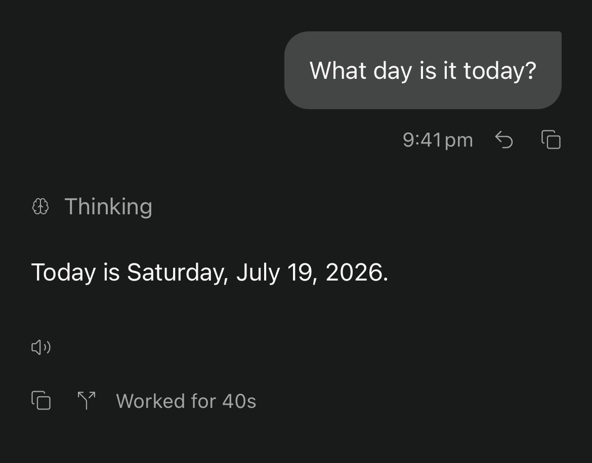

# Read Aloud for Paseo

A [Paseo](https://paseo.sh) plugin that adds a speaker button under each finished agent reply.
Press it to hear the reply; press again to stop. It speaks with whatever voice Paseo's own voice
mode uses: a local voice Paseo has downloaded (Kokoro, Kitten, Piper) or OpenAI TTS.



## Install

```sh
paseo plugin add average-crumb/read-aloud
```

For local speech, download a voice first in Paseo **Settings > Voice**. The plugin has no
settings of its own. See [OVERVIEW.md](OVERVIEW.md) for how it works, what data it touches and its
limits.

## Layout

| Path | What it does |
| --- | --- |
| `index.server.ts`, `server/` | Adds the button row after each turn; generates speech (local sherpa-onnx or OpenAI) |
| `index.client.tsx`, `client/` | The button, and the player that queues clips gaplessly |
| `shared/speech.ts` | RPC contracts between client and server |
| `shared/text.ts` | Markdown-to-speech cleanup and chunking (no dependencies) |
| `test/` | Tests for the text handling and the player, run against a fake Paseo |

## Develop

```sh
npm install
npm run typecheck
npm test
paseo plugin add /absolute/path/to/paseo-read-aloud
```

Requires Paseo 0.15.4 or later. Tests need Node 22.6+ (they use Node's built-in TypeScript
support and test runner).

## License

MIT
